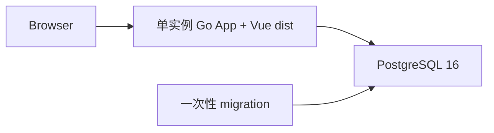

# CoinSphere

CoinSphere 是以工作流为核心、可信源码插件扩展业务的个人系统，采用 Vue/ArtDesignPro、单实例 Go 和 PostgreSQL 16。Core 5 / SDK 5 / Graph 3 提供通用编排、事务与恢复；业务数据和页面由插件拥有，无多用户、角色权限、分享、商店或兼容层。

源码仓库：[CoderLTS/coinsphere](https://github.com/CoderLTS/coinsphere)。项目标识为 `coinsphere`，Go 模块为 `coinsphere/backend`。

| 能力 | 入口 |
| --- | --- |
| 唯一账号/改密、持久菜单、系统监控 | Web + /api/v1 |
| 定义/修订/发布、调度/事件、运行/审批/制品 | 工作流 |
| AI 模型/助手/停用草稿及 modelId 节点 | AI 插件页面与顶栏 |
| HTTP/连续流、通知、QQ 收发回复 | Connector/Notification/QQ 节点 |
| 指标/策略/信号/订单意图/通用回测 | Quant 插件 |
| 公共品种/行情/补数/K 线、Paper 与导出 | Binance 插件 |
| 源码插件校验/安装/升级/卸载 | 原有 CLI/静态注册表 |

菜单以页面引用绑定，多级目录由用户安排，移动不改地址；默认布局只写一次，新增页面待挂载。g5 使用全新空库，不导入旧定义、凭据或历史；已部署系统的破坏性重建必须先保存配对恢复点。操作见[使用手册](docs/user-guide.md)。

## 架构



生产部署只运行一个包含 Vue 静态产物的 Go App 容器；一次性 migration 复用同一镜像，并连接服务器现有 PostgreSQL 16 的独立数据库。系统不依赖 Redis、消息中间件或 Kubernetes。核心 schema 保存个人认证、菜单、审计、插件生命周期、工作流执行历史和制品引用；压缩制品保存在 Backend 持久目录。

## 快速启动

推荐使用 Docker Compose。需要 Docker Engine 或 Docker Desktop，并支持 Compose v2。

```bash
git clone https://github.com/CoderLTS/coinsphere.git
cd coinsphere
```

Linux/macOS：

```bash
export COINSPHERE_AUTH__SECRET_KEY="$(openssl rand -hex 32)"
docker compose up -d --build
docker compose ps
```

PowerShell：

```powershell
$bytes = New-Object byte[] 32
[Security.Cryptography.RandomNumberGenerator]::Create().GetBytes($bytes)
$env:COINSPHERE_AUTH__SECRET_KEY = [BitConverter]::ToString($bytes).Replace('-', '').ToLowerInvariant()
docker compose up -d --build
docker compose ps
```

浏览器打开 <http://localhost:8080>。初始化只建立唯一账号和默认导航，不创建业务工作流，也不填入虚构的个人联系方式。本地初始个人账号是 `coinsphere` / `coinsphere`；首次登录后立即在“个人中心”中修改密码。`COINSPHERE_AUTH__SECRET_KEY` 必须长期保持一致，变更后已有登录令牌会失效。

本地 Compose 会启动 `postgresql`、一次性 `migrate` 和内置 Web 产物的 `backend`。停止服务不会删除数据：

```bash
docker compose down
```

完整安装、首次配置、备份和排障步骤见[使用手册](docs/user-guide.md)。

## 目录

```text
backend/             Go App、版本化 migration、工作流与系统模块
frontend/            Vue 3 + Vite Web
deploy/production/   生产 Compose 模板
docs/                架构、契约、代码/插件指南、质量门禁和 Runbook
scripts/             验证、发布和部署脚本
```

## 开发

工具链为 Go 1.26.6、Node.js 24、pnpm 10.33 和 PostgreSQL 16。默认验证交远端 CI：Go 行为/竞争、隔离 PostgreSQL、前端模型及三浏览器关键路径。仅当前任务明确要求时运行本地验证。

按模块启动与诊断见[本地开发手册](docs/runbooks/development.md)，数据库变更见[迁移手册](docs/runbooks/database-migrations.md)。

## 文档

- [使用手册](docs/user-guide.md)：安装、系统管理、插件、备份、升级和排障
- [当前架构](docs/architecture/overview.md)：系统边界、组件职责、状态流与数据所有权
- [代码结构](docs/code-structure.md)：目录、模块职责和常见修改入口
- [插件开发指南](docs/plugin-development.md)：manifest、SDK、Vue、migration、测试和生命周期
- [公共契约](docs/contracts/README.md)：`/api/v1`、插件 SDK 和生命周期语义
- [质量门禁](docs/quality/quality-gates.md)：测试与验收要求
- [发布与回滚](docs/runbooks/release.md)：手工发布、固定 digest 部署和回滚
- [Paper 恢复与观察](docs/runbooks/paper-recovery.md)：重启、积压、账本重建与观察证据

## 安全边界

凭据、真实 DSN 和生产配置不进入仓库、日志、CI、Issue、PR 或 AI 上下文。金融时间 UTC、账务 Decimal/十进制字符串，Graph 只粗粒度编排；AI/通用 HTTP 禁止交易所私有接口。当前 Binance 不含 Live/私有账户能力，正式 Paper 观察需要独立证据与用户放行。生产重建使用独立候选数据库/目录，用户验收后才删除旧专属资源及恢复资料，共享 PostgreSQL/网络保留。
