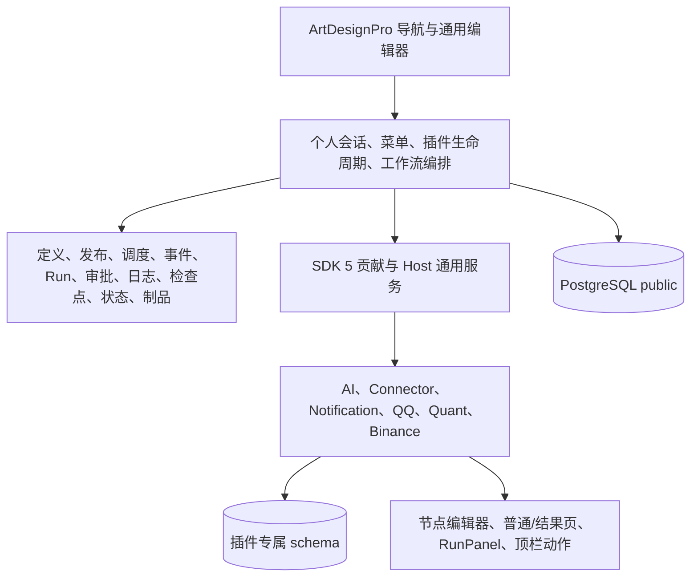

# CoinSphere 当前架构

CoinSphere 是个人工作流微内核，采用 Vue/ArtDesignPro、单实例 Go 模块化单体和 PostgreSQL 16。Core 5 / SDK 5 / Graph 3 的决策见 [ADR 0007](decisions/0007-personal-workflow-kernel.md)，接口语义见[公共契约](../contracts/README.md)。

| 所有者 | 职责 |
| --- | --- |
| Core | 唯一账号、改密/撤销会话、用户菜单；插件安装/编译/加载事实；通用编排、不可变修订、执行与恢复；个人收件箱及代理 |
| AI | 模型配置与加密密钥、助手会话/SSE、停用草稿、modelId 调用节点与顶栏聊天 |
| Connector | HTTP、协议 Ingress、连续流；公网精确域名及私网防护 |
| Notification / QQ | 内容组合、站内/钉钉/邮件与外部 QQ 收发、回复、投递幂等；QQ 保留真实 Notification 依赖 |
| Quant | 指标/条件、策略、信号、订单意图、逐帧通用回测和分析 |
| Binance | 公共品种/行情/补数/K 线、Paper 事务账本与结果导出 |
| Vue | 通用定义/运行/审批及插件贡献装配，保持 ArtDesignPro 布局、主题、表格、弹窗与标签 |

Core 不拥有业务 AI 或金融表，不调用交易所私有协议，也不执行逐 K 线计算。单账号仍需有效会话和事务复验；System/Workflow/Result Scope 约束资源存在、节点归属与当前页面请求。

## 定义与运行

Workflow 分离 draft/published 指针。保存定义/metadata/Secret 原子提交，发布显式指定修订与预期指针；自动入口只绑定发布定义，手动试运行不发布。修订、运行快照与检查点不可变，旧 Run 引用不阻止保存新草稿。

Run 使用有界执行池、PostgreSQL 持久队列与租约 token；调用、状态、日志、检查点和终态均受租约保护。persistent 状态按 workflow/revision/node 隔离并串行提交。审批创建、waiting、一次性决定及恢复同事务；取消、过期和 supersede 释放等待。unknown_result 不自动重试，诊断仅复用已有副作用检查点。

## 扩展与导航

插件继续以源码目录、coinsphere-plugin.json、CLI 和静态注册表接入，无商店。安装版本与编译版本精确匹配才加载，真实依赖和贡献冲突必须明确失败。插件同进程可信，Scope 不提供恶意代码沙箱。

菜单引用 pluginId/contributionType/pageKey，地址由贡献生成，层级由用户配置。默认布局由一次 marker 控制，重启、升级及重载不覆盖；新页面在待挂载目录。缺插件保留菜单并隐藏入口；菜单不阻止卸载，当前定义和在途 Run 继续维护活动引用。

## 初始化与部署

g5 在空 PostgreSQL 16 建立 public 与 plugin_ai/plugin_quant/plugin_binance/plugin_notification 及各自版本账本。启动只验证版本，随后加载插件、写一次账号与导航并启动执行器。旧数据不迁移，业务工作流不自动创建/启用。

候选使用独立 Compose 项目、数据库及文件目录；失败恢复只操作 backend。用户验收后才清理旧专属容器、库、文件、配置和备份，共享 PostgreSQL/网络保留。步骤见[发布手册](../runbooks/release.md)。
